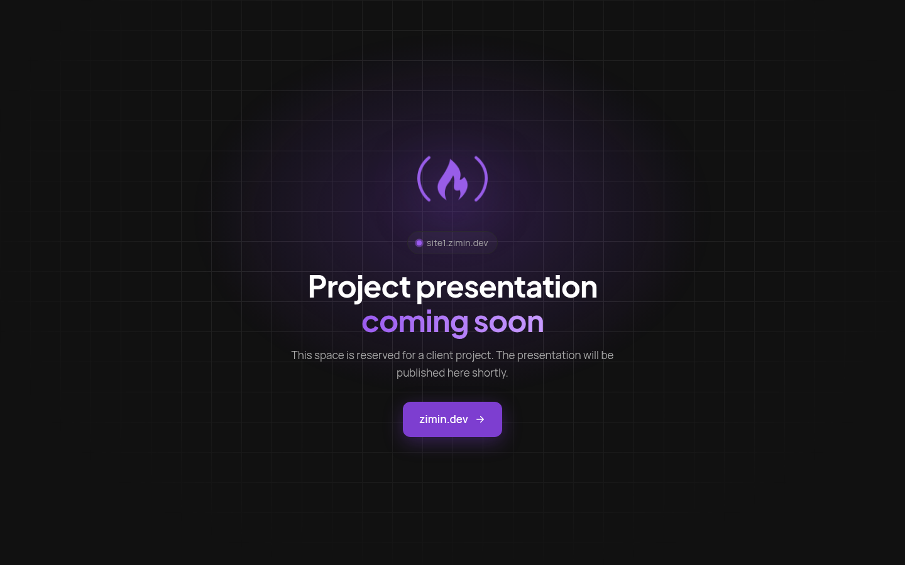
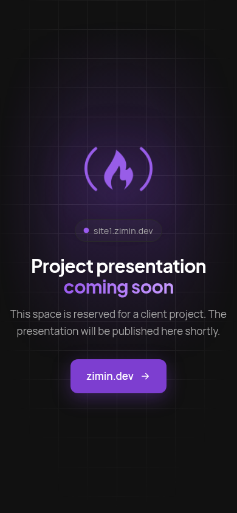
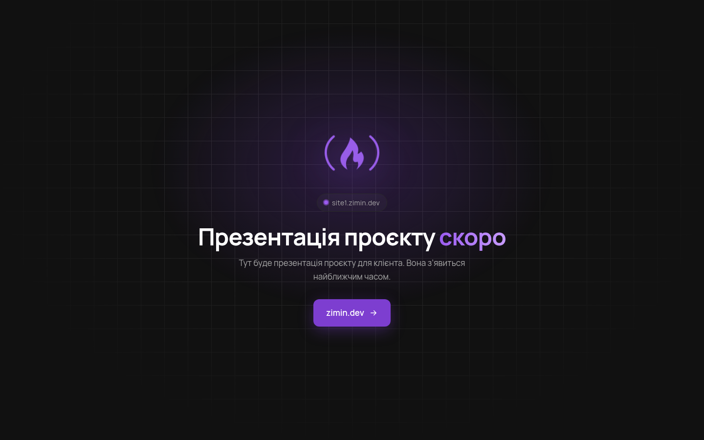

# Placeholder | Zimin.Dev

A placeholder page with the Zimin.Dev logo for subdomains that will later host client project presentations (site1–site9.zimin.dev). Static HTML with no dependencies and no third-party requests.



<p> </p>

- Dark design in the zimin.dev colours (#111111, #7d3ed0), a softly animated logo and a **zimin.dev** button.
- The pill under the logo shows the current hostname (`site3.zimin.dev` etc.), so one file fits every subdomain.
- The text is in English and switches to Ukrainian, German, Polish, French or Russian based on the browser language.
- The Manrope and Plus Jakarta Sans fonts are bundled with the page.
- Hidden from search engines: `robots.txt`, `<meta name="robots">` and an `X-Robots-Tag` header in `.htaccess`.
- `.htaccess` sets `RewriteEngine On`, so WordPress rules from a parent folder (`/home/<user>/.htaccess`) are not inherited and don't cause a 500 error. It also turns off directory listing and sets `index.html` as the index.

## Installation

Copy `index.html`, `robots.txt`, `.htaccess` and the `assets/` folder to the site root (or unzip the archive from the Release).

```sh
scp -r index.html robots.txt .htaccess assets user@server:/home/user/subdomains/site1.example.com/
```

## Changelog

- **1.0.1**: the button text is now «zimin.dev» in every language, and the footer credit was removed.
- **1.0.0**: first release.

---

Sasha Zimin · [zimin.dev](https://zimin.dev)
